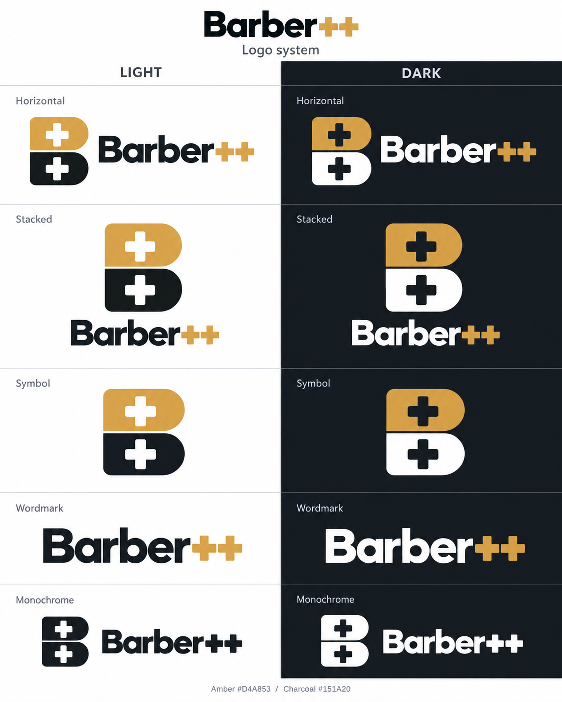
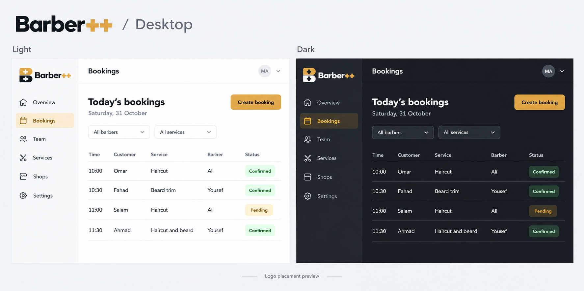
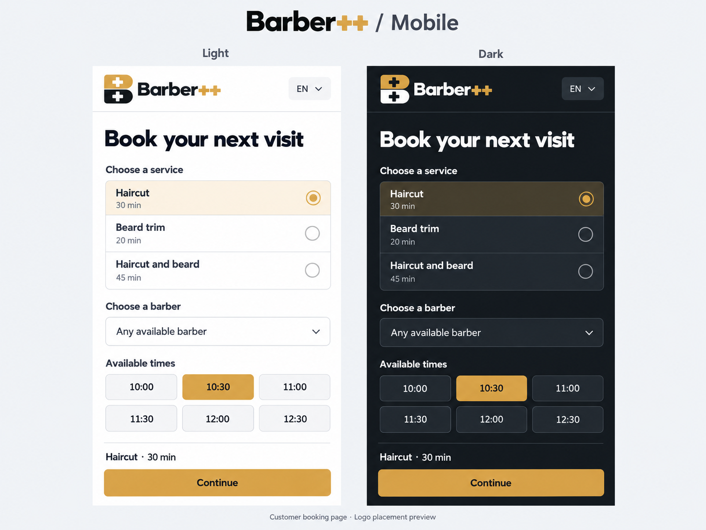
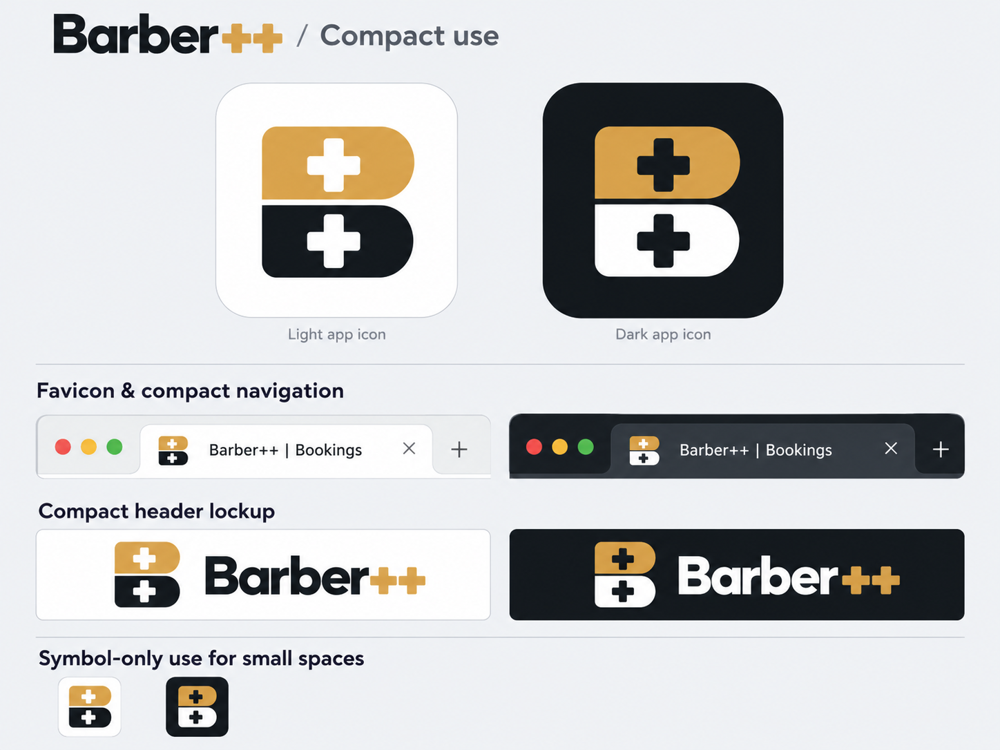

# Barber++ — Bright Minimal

Design system · Version 1.2 · Updated 31 October 2026

## Direction and scope

The selected Bright Minimal homepage establishes the direction: a white canvas, strong charcoal typography, warm amber actions, clear product previews, and generous space. This system extends that direction into reusable components for the homepage and the management app. Owners and teams should quickly understand what the product does and see what to do next.

The Bright Minimal direction and the two-tone B-with-++ logo are selected. The logo direction was approved on 31 October 2026. Detailed component specifications remain proposed. Customers create appointments through a booking page; WhatsApp is no longer part of the product.

This document covers the light interface system and the logo's light, dark, compact and single-color treatments. The desktop and mobile dark previews demonstrate logo placement; a complete dark interface component specification remains outside this document. The linked assets are design references and presentation boards.

The visual sheets communicate appearance. This document is authoritative for exact values, state behavior, and accessibility details where generated images differ. Mockup appointments, names, metrics, and shops are illustrative. The new logo section supersedes earlier wordmark-only treatments in the original foundations and component sheets.

## 1. Color

| Semantic token | Value | Use |
| --- | --- | --- |
| surface | #FFFFFF | Page, cards, fields |
| surface-subtle | #F7F8FA | Product canvas, secondary sections |
| surface-hover | #F0F2F5 | Neutral control and row hover |
| text-primary | #151A20 | Headings, body emphasis, text on amber |
| text-secondary | #596473 | Supporting text, table headers, placeholders |
| action-primary | #D4A853 | Main action fill, brand accent |
| action-hover | #C5973E | Primary button hover |
| action-active | #B68A35 | Primary button pressed state |
| action-subtle | #FBF5E8 | Selected item background, accent icon backing |
| text-link | #805B18 | Text links, selected labels on light surfaces |
| focus-ring | #805B18 | Visible keyboard focus |
| border-subtle | #E3E7ED | Decorative dividers, card outlines |
| border-control | #7C8795 | Fields and outlined interactive controls |
| surface-inverse | #22292F | Optional product-preview sidebar |
| text-inverse | #FFFFFF | Text on inverse surface |
| success / success-surface | #176B4A / #EAF6EF | Confirmed and positive feedback |
| warning / warning-surface | #805B18 / #FFF5DF | Pending and attention |
| danger / danger-surface | #B42318 / #FFF1F0 | Errors and cancelled bookings |
| info / info-surface | #2456A6 / #EEF4FF | Informational feedback |

Amber is an action accent, not a body-text color. Use dark text on amber buttons. Use text-link for amber-family text on white. Decorative light borders must not be the only way a user can recognize a field or interactive control.

Calculated contrast for the specified solid colors: text-primary on action-primary **7.93:1**; text-secondary on white **6.01:1**; text-secondary on surface-subtle **5.65:1**; text-link on white **6.13:1**; border-control against white **3.65:1**. White text on the selected amber is only **2.20:1**, so it is intentionally replaced with dark text.

## 2. Typography

Use **Outfit** for English headings and body text, retaining the app's existing body font. Use **Noto Sans Arabic** for Arabic. Use weights 400, 500, 600 and 700 only where needed. The approved wordmark follows the bold geometric direction of Outfit at weight 700, with the two plus signs in amber. Use the approved wordmark reference when preparing final artwork; avoid retyping it differently for each placement. Preserve its left-to-right lettering in Arabic layouts.

| Role | Desktop size / line height | Mobile size / line height | Weight |
| --- | --- | --- | --- |
| Display | 64 / 72 px | 40 / 48 px | 600 |
| Section heading | 40 / 48 px | 32 / 40 px | 600 |
| Page heading | 32 / 40 px | 28 / 36 px | 600 |
| Card title | 24 / 32 px | 22 / 30 px | 600 |
| Introductory text | 20 / 30 px | 18 / 28 px | 400 |
| Body | 16 / 24 px | 16 / 24 px | 400 |
| Label / button | 14 / 20 px | 14 / 20 px | 500–600 |
| Supporting metadata | 12 / 18 px | 12 / 18 px | 400–500 |

Use 16 px text inside form fields. Essential instructions and errors use at least 14 px. English display headings may use -0.025em tracking; body text uses normal tracking. Arabic uses normal tracking at all sizes, with body line height 28 px and display line height 1.35. Do not truncate Arabic diacritics or force the English line breaks into translations.

Keep paragraph width near 60–70 characters and hero copy within 720 px. Allow content to reflow and grow when text is enlarged.

Sources: [Outfit specimen](https://fonts.google.com/specimen/Outfit), [Noto Sans Arabic specimen](https://notofonts.github.io/noto-docs/specimen/NotoSansArabic/). Font binaries and their license notices should be packaged and verified during implementation; no fonts are bundled in this proposal.

## 3. Approved logo system

The approved identity is a capital **B with two plus-shaped negative spaces**. Its upper half is amber and its lower half is charcoal on light surfaces. Two aligned blocks, a narrow horizontal separation and equal plus apertures are essential to the identity.

The [selected stacked logo](approved-b-plus-logo-system-2026-10-31/approved-stacked-light.png) is the visual reference for the approved direction. Use the [variant index](logo-variants.json) to locate all treatments and their presentation files. Earlier logo explorations in other folders are not approved brand assets.

### Geometry and color

- Preserve the straight left spine, two rounded right bowls, small waist indentation and overall B proportions from the selected reference.
- Keep the two plus apertures equal in size, aligned vertically and open to the background. The waist separation also reveals the background. In final vector or transparent artwork these are true cutouts.
- Keep the upper and lower halves aligned. Use the horizontal split from the approved logo; do not substitute the earlier diagonal folded corner, spiral or linked-bracket concepts.
- Retain the exact brand name **Barber++**, including both plus signs. In full-color treatments the wordmark's plus signs are amber.
- Use uniform solid colors. Gradients, metallic effects, texture, glow and shadows are not part of the logo specification, even if a generated preview contains slight rendering variation.

| Treatment | Upper B half | Lower B half | Plus apertures and waist gap | Wordmark | Intended surface |
| --- | --- | --- | --- | --- | --- |
| Full color, light | #D4A853 | #151A20 | Show the light background | #151A20 “Barber”, #D4A853 “++” | White or the light neutral surface |
| Full color, dark | #D4A853 | #FFFFFF | Show the dark background | #FFFFFF “Barber”, #D4A853 “++” | #151A20 or the inverse surface #22292F |
| Single color, dark ink | #151A20 | #151A20 | Show the light background | Entire wordmark #151A20 | Light surface; one-ink applications |
| Single color, reversed | #FFFFFF | #FFFFFF | Show the dark background | Entire wordmark #FFFFFF | Dark surface; one-ink applications |

The logo reuses the system's existing amber, primary text and inverse text colors. A dark page requires the reversed logo treatment so the lower half of the B remains visible. Keep apertures as background openings when changing themes.

### Variant matrix

Every form below has a light and dark presentation. Single-color treatments use the ink rules above.

| Form | Composition | Primary use | Visual reference |
| --- | --- | --- | --- |
| Horizontal | Symbol at left, wordmark at right | Desktop header, expanded sidebar, website navigation | [Logo sheet — Horizontal row](approved-b-plus-logo-system-2026-10-31/01-logo-variations.png) |
| Stacked | Symbol above the centered wordmark | Brand introductions, sign-in or welcome compositions, spacious marketing placements | [Logo sheet — Stacked row](approved-b-plus-logo-system-2026-10-31/01-logo-variations.png) |
| Symbol only | B with two plus cutouts; no wordmark | Compact navigation and spaces where the brand is already established | [Logo sheet — Symbol row](approved-b-plus-logo-system-2026-10-31/01-logo-variations.png) |
| Wordmark only | Barber++ lettering; no separate B | Secondary signatures and text-led brand placements | [Logo sheet — Wordmark row](approved-b-plus-logo-system-2026-10-31/01-logo-variations.png) |
| Monochrome | Symbol and wordmark in one ink | Single-color print and reversed use | [Logo sheet — Monochrome row](approved-b-plus-logo-system-2026-10-31/01-logo-variations.png) |
| App icon | Symbol centered on a light or dark square field with safe padding | App-icon presentation and future platform-specific icon exports | [Compact-use sheet — App icons](approved-b-plus-logo-system-2026-10-31/04-app-icon-favicon.png) |
| Favicon | Symbol only at small browser-tab scale | Browser tabs and bookmark icons | [Compact-use sheet — Favicons](approved-b-plus-logo-system-2026-10-31/04-app-icon-favicon.png) |
| Compact header | Horizontal form adapted to the available header space | Mobile booking-page header and compact navigation | [Compact-use sheet — Header lockups](approved-b-plus-logo-system-2026-10-31/04-app-icon-favicon.png) |

### Clear space and responsive placement

These sizing rules are implementation starting points to validate against the final vector master and real English/Arabic layouts. The presentation boards do not establish pixel-perfect minimum sizes.

- Define **x** as the thickness of one arm of a plus aperture in the symbol. Reserve at least **x** of clear space around a complete lockup or standalone symbol. For wordmark-only use, reserve at least half its capital-letter height.
- Scale the complete chosen lockup proportionally. Preserve the symbol-to-wordmark spacing shown in its reference instead of independently stretching or compressing either part.
- **Desktop:** start with a horizontal lockup around 180–200 CSS px wide and a symbol around 32–40 CSS px high in the existing 80 px header. Expanded sidebars use the horizontal form; collapsed sidebars use the symbol.
- **Mobile:** start with a horizontal lockup around 140–165 CSS px wide and a symbol around 28–32 CSS px high in the existing 64 px header. Switch to the symbol when space is insufficient; do not squeeze the wordmark or clip a plus sign.
- **Small UI symbols:** start at 24 CSS px or larger. Validate that both plus apertures and the waist gap remain distinct at actual display size.
- **Favicons:** use the dedicated 16, 32 and 48 px PNGs or adaptive SVG in [production-logo](production-logo/README.md). These are exported from the vector master; presentation boards remain placement references.
- **App icons:** center the symbol with generous safe padding on white or charcoal. The rounded tile in the preview is an application container, not part of the core B geometry. Apply the target platform's mask during export.
- A clickable logo needs a 44 × 44 CSS px minimum interactive target, even when its visible artwork is smaller. Keep the keyboard focus ring outside the artwork and unclipped.

### Desktop, mobile and theme references

The [desktop sheet](approved-b-plus-logo-system-2026-10-31/02-desktop-light-dark.png) shows the horizontal logo in an owner/manager booking workspace. The [mobile sheet](approved-b-plus-logo-system-2026-10-31/03-mobile-light-dark.png) shows its compact use on the customer booking page. Both demonstrate the same selected identity in light and dark contexts; sample screens and appointment data are illustrative.

### Arabic and accessible naming

Keep the B and the Latin **Barber++** lettering in their original orientation in both locales. Surrounding navigation follows RTL layout; the logo itself is not mirrored or manually reordered. An Arabic wordmark has not been approved.

Use “Barber++” as the accessible name of an informative logo. A home-link logo should have a localized accessible name such as “Barber++ home” / “الصفحة الرئيسية لـ Barber++”. Avoid duplicate announcements when an icon and wordmark form one link: expose one accessible name for the complete brand link.

### Asset inventory and delivery status

| Asset | Role | Delivery status |
| --- | --- | --- |
| [approved-stacked-light.png](approved-b-plus-logo-system-2026-10-31/approved-stacked-light.png) | Canonical visual reference for the selected logo | Approved direction; PNG on a light background |
| [01-logo-variations.png](approved-b-plus-logo-system-2026-10-31/01-logo-variations.png) | Horizontal, stacked, symbol, wordmark and monochrome treatments | PNG presentation board |
| [02-desktop-light-dark.png](approved-b-plus-logo-system-2026-10-31/02-desktop-light-dark.png) | Desktop light/dark usage | PNG placement preview |
| [03-mobile-light-dark.png](approved-b-plus-logo-system-2026-10-31/03-mobile-light-dark.png) | Mobile light/dark usage | PNG placement preview |
| [04-app-icon-favicon.png](approved-b-plus-logo-system-2026-10-31/04-app-icon-favicon.png) | App-icon, favicon and compact-header usage | PNG presentation board |
| [Presentation pack ZIP](approved-b-plus-logo-system-2026-10-31/Barber++-logo-presentation-pack.zip) | Boards, selected original, prompts and Canva upload references | Presentation archive |
| [logo-variants.json](logo-variants.json) | Structured index of approved forms, treatments and reference files | Design documentation; not a runtime asset loader |

Production artwork is available in [production-logo](production-logo/README.md): clean SVG masters, the outlined Outfit Bold wordmark, transparent light/dark and monochrome PNG lockups, plus dedicated app-icon and favicon exports. The plus apertures and waist are true cutouts. The bundled OFL license covers the source font. Use these assets directly; do not crop presentation boards for application use. The original foundations and component PNGs remain historical interface references; their older wordmark-only branding is superseded by this logo system.

## 4. Space, layout, shape and motion

| Token family | Values / behavior |
| --- | --- |
| space | 4, 8, 12, 16, 24, 32, 48, 64, 96 px |
| Content width | 1200 px maximum, centered |
| Mobile, below 768 px | 4 columns; 16 px gutters; 20 px outer margins |
| Tablet, 768–1023 px | 8 columns; 24 px gutters; 32 px outer margins |
| Desktop, 1024 px and up | 12 columns; 24 px gutters; at least 40 px outer margins |
| Section spacing | 96 px desktop; 64 px tablet; 48 px mobile |
| Card padding | 24 px desktop; 16 px mobile |
| Control radius | 8 px |
| Card radius | 12 px |
| Large preview / dialog radius | 16 px |
| Badge radius | Fully rounded; do not apply to all buttons |
| Card elevation | Usually none; a 1 px border is enough |
| Raised panel shadow | 0 8px 24px rgba(21,26,32,0.08) |
| Focus treatment | 2 px focus-ring outline, 3 px offset; never clipped |
| Motion | 150 ms color/opacity changes; 200 ms disclosure transitions |

Use 20 or 24 px outline icons with a consistent 1.5 px stroke. Reuse the app's existing Lucide icon family. Icon-only buttons need an accessible name and a 44 × 44 px target. Use text labels for unfamiliar actions.

No floating decorations, glow, texture overlays, gradient fills, parallax or autoplay animation. Respect reduced-motion preferences by removing movement and nonessential transitions. Loading must remain understandable without animation.

## 5. Component specifications

| Component | Appearance and dimensions | States and behavior |
| --- | --- | --- |
| Primary button | Amber fill, dark text, 1 px dark-amber border, 8 px radius; 44 px height, 20 px horizontal padding; hero variant 48 px high | Hover uses action-hover; pressed uses action-active; keyboard focus adds external ring; disabled uses #F0F2F5 with #596473 text; loading retains width and shows spinner plus a verb such as “Saving…”; suppress duplicate submission |
| Secondary button | White fill, text-primary, border-control; same size as primary | Hover surface-hover; pressed #E3E7ED; same focus, disabled and loading rules |
| Text action | text-link, 14–16 px; underline inline links in prose | Hover/active underline; focus ring around target; at least 44 px target in navigation or toolbars |
| Destructive button | danger fill, white text; use only for destructive operations | Hover #981B12; pressed #7A1810; explicit verb such as “Delete shop”; retain common focus/loading rules |
| Input / textarea | Visible label, 8 px label gap, white surface, border-control, 8 px radius, 16 px input text, at least 44 px height | Hover darkens border; focus ring; filled, read-only and disabled states; error uses danger border, icon and specific helper text; preserve entered data |
| Select / filter | Same field styling; selected text and chevron; “All shops” is the unfiltered label | Open, selected, empty results, keyboard focus, disabled; mobile list must fit viewport; include “Clear filters” when filters are active |
| Checkbox / radio / switch | 20 px visible control within a 44 px target, adjacent label; dark border | Unchecked, checked, indeterminate where relevant, focus and disabled; selection uses amber with dark check/dot; no color-only indication |
| Card | White, border-subtle, 12 px radius, 24 px padding | Default static cards do not lift on hover; clickable cards need a clear link and keyboard focus; loading placeholder, empty and failure content use the same footprint |
| Metric | 14 px descriptive label, 32/40 px value, optional small outline icon | Show units with the value; loading skeleton; unavailable value uses an em dash and explanation; no invented trends |
| Status badge | 12/18 px medium text, 6 px vertical and 10 px horizontal padding, small icon | Confirmed: success + check; Pending: warning + clock; Completed: neutral + double-check; Cancelled: danger + x; readable label always present |
| Booking table | 48 px header, minimum 56 px rows; 14 px text; time, service, barber, status; subtle horizontal rules | Hover surface-subtle; selected row action-subtle plus checkbox; show sorting indicator and expose sort state; empty, loading, error, pagination; row actions have named 44 px targets |
| Navigation | 80 px desktop header, white surface, approved horizontal logo sized using the logo-system guidance, clear active item | At narrow widths use a 64 px header with the compact lockup or symbol and menu; expanded menu includes login, language and primary action; close via explicit close control and Escape; return focus to menu trigger |
| Tabs | Text labels with 2 px underline and weight change for active tab | Selected, hover, focus, disabled; use keyboard arrow navigation; distinguish tabs from normal navigation links |
| Accordion | 56 px minimum trigger row with label and chevron, thin separators | Expanded/collapsed, hover, focus; button announces expansion; content flows naturally with translations |
| Alert / toast | Status icon, short title, concise explanation; pale semantic surface | Success, info, warning, error; never hide critical errors only in transient toast; status announced appropriately; offer retry where useful |
| Dialog | White, 16 px radius, 480 px typical maximum width, 24 px padding, subtle shadow | Descriptive title, visible close, safe cancel, one primary action; focus contained and returned on close; Escape closes ordinary dialogs; mobile inset 20 px with internal scroll |
| Pagination | “Previous”, page state, “Next”; 44 px targets | Current page marked; unavailable directions disabled; mobile may use previous/next and page count |

Each action has one clear verb. Use “Get started” for the marketing conversion, “Create booking” for booking creation, and “Save changes” for edits. Avoid ambiguous icon-only actions and generic errors. Use “shop” (صالون) in customer and other non-admin wording; reserve “branch” (فرع) for admin-facing interfaces.

### Shared feedback patterns

- **Empty:** “No bookings yet.” Follow with “Create your first booking to organise the day.” and a “Create booking” action when the role permits it.
- **Filtered empty:** “No bookings match these filters.” Provide “Clear filters”.
- **Loading:** preserve layout with low-contrast placeholders; show meaningful loading text to assistive technology; do not show sample values as real data.
- **Failure:** “Couldn't load bookings.” Provide “Try again”. Keep filters and entered information intact.
- **Success:** “Booking created.” Keep confirmation visible long enough to understand; move to the new booking only when appropriate to the flow.
- **Validation:** validate after leaving a field or submitting; identify the field and correction, connect helper text to the input, and focus the first invalid field after submission.

## 6. Responsive composition and Arabic

The desktop homepage keeps the selected sequence: navigation → centered headline and two actions → wide product preview → three feature columns → closing CTA → footer. Keep the heading “Your shop. Your team. All in one place.” and the supporting sentence “Manage bookings, barbers, and every shop from one calm workspace.”

On tablet, reduce display type to 48/56 px and preserve generous margins. On mobile, use 40/48 px display type, stack the actions at full width, replace the miniature desktop dashboard with a readable schedule summary, stack the feature columns, and stack the closing CTA. The marketing preview must communicate its purpose without requiring the user to zoom into a dense table.

In the working app, mobile booking cards retain time, client, service, barber, status and actions. If a task genuinely requires column comparison, keep an explicitly scrollable table rather than silently hiding important columns. Keep filters and pagination reachable.

Arabic layouts mirror navigation order, sidebar placement, field alignment, directional arrows, and component start/end spacing. Do not mirror the logo, clock faces, charts indiscriminately, or non-directional icons. Keep phone numbers, email addresses and mixed-language identifiers isolated in their natural reading direction. Format dates, numerals and currency consistently for the selected locale; avoid manually reversing strings.

Proposed Arabic headline: “كل تفاصيل صالونك، في مكان واحد”. Proposed CTA: “ابدأ الآن”. Arabic labels should use natural phrasing and adequate line height, without added letter spacing. Verify real Arabic content before implementation sign-off.

## 7. Accessibility and validation

Target WCAG 2.2 AA in implementation. The design uses at least 4.5:1 for normal text, 3:1 for qualifying large text and necessary control boundaries, visible focus, semantic labels, non-color status cues, and reflow. See [W3C contrast guidance](https://www.w3.org/WAI/WCAG22/Understanding/contrast-minimum.html).

The chosen 44 px touch-target rule is a product standard, intentionally more generous than the WCAG 2.2 AA minimum of 24 CSS pixels with its defined exceptions. See [W3C target-size guidance](https://www.w3.org/WAI/WCAG22/Understanding/target-size-minimum.html).

Contrast values above were calculated from the exact proposed hex colors. A generated image cannot establish implementation conformance. Before release, validate keyboard operation, focus visibility and order, screen-reader labels, reduced motion, text resizing, 320 px reflow, and both English and Arabic with real content.

## 8. Future token mapping — no code changes made

| Proposed system role | Existing token or future extension |
| --- | --- |
| surface / surface-subtle / surface-hover | --bg-primary / --bg-secondary / --bg-hover |
| text-primary / text-secondary | --text-primary / --text-secondary |
| action-primary | --accent-primary |
| action-hover / action-active / text-link / focus-ring | New semantic tokens during an approved implementation |
| border-subtle / border-control | Separate semantic border tokens during implementation |
| English heading and body | --font-display and --font-body both use Outfit in this direction |
| Arabic heading and body | Locale-specific font override using Noto Sans Arabic |
| success, warning, danger, info | Existing --status-* families with the proposed light-theme values |
| 8 / 12 / 16 px radius | Existing --radius-md / --radius-lg / --radius-xl |
| Existing space values | Keep existing 4, 8, 16, 24, 32, 48, 64 px; extend with 12 and 96 px |

This mapping is a future handoff only, not a change to the current theme or a requirement to redesign every application screen now.

## 9. Handoff status

- Selected direction: Bright Minimal; the two-tone B with two plus-shaped cutouts was approved on 31 October 2026.
- Delivered: original foundations/component sheets; the approved logo reference; light/dark logo-variant, desktop, mobile and compact-use presentation boards; the presentation ZIP; and this exact-value specification with a structured logo-variant index.
- Image method: built-in image generation using the selected visual references. Logo boards are PNG presentation assets; generated interface examples illustrate placement.
- Intentional refinement: dark labels on amber actions for readable contrast; other structure and tone preserve the selected direction.
- Logo production handoff is complete. Detailed component acceptance and a full Arabic typography review remain separate from this logo-only rollout.
- The shared `BrandLogo` component applies the new identity to landing, staff authentication, staff sidebars and customer booking/account headers. Customer booking keeps its light treatment on its always-light surface. The artwork stays LTR in Arabic. No editable Figma component library is included.

## 10. Revision history

| Version | Date | Change |
| --- | --- | --- |
| 1.1 | 31 October 2026 | Added the approved B-with-++ identity, all presented logo treatments, responsive placement guidance, light/dark usage boards, asset inventory and export status. |
| 1.0 | 17 September 2026 | Established the Bright Minimal interface direction, tokens and component proposal. |

| 1.2 | 31 October 2026 | Added production SVG/transparent PNG assets, outlined font license, native browser/app icons and shared application branding. |
